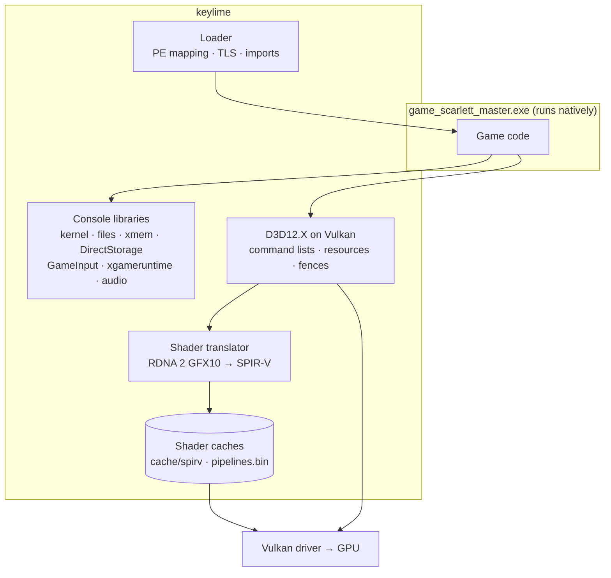
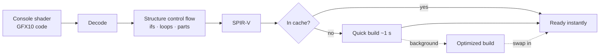

<h1 align="center">🍋‍🟩 keylime</h1>

<p align="center">
  <b>Xbox Series game code, running natively on Windows — on Vulkan.</b><br>
  A from-scratch C++20 runtime. First target: <b>GTA VI</b> (Xbox Series build).
</p>

<p align="center">
  
  
  
  
  
</p>

<p align="center">
  <a href="#where-we-are">Where we are</a> •
  <a href="#how-it-works">How it works</a> •
  <a href="#building">Building</a> •
  <a href="#running">Running</a> •
  <a href="#troubleshooting">Troubleshooting</a> •
  <a href="#other-projects">Other projects</a> •
  <a href="#credits-and-licence">Credits</a>
</p>

> [!IMPORTANT]
> keylime contains **no game files, keys or console SDK code**. You need your own copy of the game.
> Nothing here downloads or distributes game content.

---

## Where we are

<table>
<tr>
<td width="33%" valign="top">

### ✅ Working
- Retail exe boots natively
- Intro, main menu, loading screen
- **Locked 30 fps** through the menus
- All audio (XMA, Opus, DSP)
- DirectStorage streaming + BCPack
- Frames render on Vulkan

</td>
<td width="33%" valign="top">

### 🚧 In progress
- **Opening cutscene**: audio plays,
  picture doesn't draw yet
- Shader compile time on first use
- Precompiled shader cache
- Mesh shaders (amplification
  shaders still skipped)

</td>
<td width="33%" valign="top">

### ❌ Not yet
- Gameplay
- Multi-argument `ExecuteIndirect`
- Amplification shaders
- Depth export from pixel shaders

</td>
</tr>
</table>

### Milestones


- [x] Retail exe boots natively; archives stream through DirectStorage
- [x] Intro and main menu with all audio
- [x] World loading after the menu, into the opening cutscene
- [x] `ExecuteIndirect` (single-argument signatures) and GPU memory waits
- [x] Mesh shader dispatches without an amplification shader
- [ ] Opening cutscene drawn at 15+ fps
- [ ] Amplification shaders, multi-argument `ExecuteIndirect`
- [ ] Gameplay

### What we're fighting right now

| Problem | What happens | Status |
|---|---|---|
| **New shaders at the cutscene** | ~3,000 compute pipelines appear at once; each must be translated and compiled by the driver before the game can continue | Urgent compile queue, compiles start when a list is recorded, `keylime precompile`, background builds throttled — compiles went from 35–60 s to ~1 s each |
| **Translated shaders are big** | ~50× more SPIR-V than console code; NVIDIA spends ~25 CPU-seconds per big shader | Control flow is now fully structured (was "run by number"); shrinking the output is next |
| **Wrong data from some compute shaders** | Stores to addresses gigabytes past any buffer; GPU counters the game waits on are never written; the game traps on bad data (`int3`) | Stores outside GPU memory are skipped and logged; root cause being traced |
| **Game's GPU watchdog** | Ends the game when GPU work takes ~25 s | Its thread is parked instead (`KEYLIME_WATCHDOG=1` to disable) |

### Component status

| Area | State |
|---|---|
| Loader (PE mapping, static TLS redirect, import binding) | 🟢 working |
| Kernel, files (`G:` package, `T:` temp), memory (`xmem`, physical pages) | 🟢 working |
| DirectStorage (worker pool, zlib, BCPack) | 🟢 working |
| GameInput (XInput pads, keyboard as a pad) | 🟢 working |
| Audio: AcpHal XMA, Opus (`xapu`), DSP (`chad`) | 🟢 working (reverb is dry) |
| `xgameruntime` (XUser, XStore, XGameSave, XAsync, …) | 🟡 enough for the menus; some stubs |
| XG texture layouts (AMD addrlib) | 🟢 working |
| GPU objects: device, queues, fences, lists, heaps, resources, views, pipelines | 🟢 working |
| GFX10 decoder and GFX10 → SPIR-V translator | 🟡 every shader seen so far translates; some compute results are wrong |
| Running the game's command lists on Vulkan | 🟡 menus fully; cutscene runs but doesn't draw |

---

## How it works

We don't emulate the CPU. The console's x86-64 code runs directly on the host CPU; keylime supplies
everything around it — the loader, the console system libraries, and a GPU layer on Vulkan with our
own translator from the console's RDNA 2 machine code to SPIR-V.



### Design choices

| | keylime |
|---|---|
| Graphics API | Vulkan 1.3 / 1.4 |
| Shaders | SPIR-V written directly from GFX10 machine code — no HLSL or DXIL round trip |
| Memory | Title memory imported zero-copy behind a GPU page table (console addresses → wherever the page lives) |
| Descriptors | Real RDNA 2 descriptor words; images and samplers found through a GPU hash table into bindless arrays |
| Queues | Asynchronous, timeline semaphores, no wait after each submission |
| Shader compiles | Never on the game's threads; urgent queue for what a draw or dispatch waits on; two-level disk cache |
| Frame pacing | High-resolution waitable timers |

More detail: [`docs/translator.md`](docs/translator.md) · [`docs/rdna2-descriptors.md`](docs/rdna2-descriptors.md)

### Shader pipeline



---

## Building

**Needs:** Windows 10/11 x64 · Visual Studio 2022 (or Build Tools) with the C++ workload (CMake and
Ninja ship with it) · a GPU driver with Vulkan 1.3.

```powershell
powershell -File tools\build.ps1
```

## Running

```powershell
tools\play.ps1                                              # live log console + the game
build\keylime.exe run <dir>\game_scarlett_master.exe --execute
```

| Command | What it does |
|---|---|
| `keylime run <exe> --execute` | Run the game |
| `keylime precompile <dir>` | Build every compute shader dumped in `<dir>` into the caches, on all cores |
| `keylime imports <exe>` | Map and bind only; list unimplemented functions |
| `keylime shader <dir\|file> [--dis]` | Parse or disassemble console shader containers |
| `keylime shader <dir> --spirv` | Translate shaders and build them as driver pipelines |

### Controls

A keyboard stands in for a controller (any XInput pad works too).

| Key | Pad | Key | Pad |
|---|---|---|---|
| Enter | A | Backspace | B |
| Esc | Menu | Tab | View |
| Arrows | D-pad | WASD / IJKL | Left / right stick |
| Q / E | Shoulders | Z / C | Triggers |

**F3** toggles the debug panel (fps, frame-time graph, GPU work, shader compiles, VRAM, streaming).

### Shader cache

The first time the game uses a shader, it has to be translated and compiled — that's what makes a
first run stutter. To build the cache ahead of time:

```powershell
$env:KEYLIME_DUMP_SHADERS = "D:\keylime\logs\dump"   # 1. play once: every shader is saved here
build\keylime.exe precompile D:\keylime\logs\dump     # 2. build them all on every core
```

Later runs load them from `cache\spirv` and `cache\pipelines.bin`. A change to the translator
starts the cache over.

### Environment variables

| Variable | Effect |
|---|---|
| `KEYLIME_TRACE=1` | Detailed logging |
| `KEYLIME_OVERLAY=0` | Start with the debug panel hidden |
| `KEYLIME_DUMP_SHADERS=<dir>` | Save every shader the game uses (for `precompile`) |
| `KEYLIME_KEYS=14:RETURN,30:A` | Scripted key presses at those seconds (testing without a person) |
| `KEYLIME_SNAPSHOTS=<dir>` | Save some shown frames as BMP files |
| `KEYLIME_STACKS_AT=<s>` | Log every thread's stack at that second |
| `KEYLIME_STORE_GUARD=0` | Don't skip shader stores outside GPU memory |
| `KEYLIME_WATCHDOG=1` | Let the game's GPU watchdog end the game |
| `KEYLIME_VALIDATION=1` | Vulkan validation layers |

## Troubleshooting

| File | What's in it |
|---|---|
| `logs\keylime.log` | Full log; every 2 s a `frame:` line (ms per frame, GPU busy, pipeline waits, work run and skipped) and a `compile:` line |
| `logs\crash.dmp` | Minidump of an unhandled crash (each distinct fault is also logged once) |
| `logs\stacks.txt` | Every thread's stack when no frame is shown for 5 s and 20 s, plus what each GPU queue waits on |
| `cache\used-pipelines.txt` | Pipelines used so far; the next run starts them as soon as the game creates them |

---

## Other projects

Several projects are working on GTA VI's Xbox build on PC. keylime is in the same family as VIctory
and XCL — the console's own x86-64 code runs natively, with the system libraries and GPU replaced
around it — but we take a different graphics path: we drive Vulkan and write SPIR-V ourselves, where
the others go through Direct3D 12 and DXIL.

| Project | Approach | Scope | Graphics path |
|---|---|---|---|
| **keylime** | Native runtime, C++20, from scratch | GTA VI first | Vulkan; RDNA 2 → SPIR-V directly |
| [VIctory](https://github.com/Marvisak/VIctory) | Compatibility layer, Rust | GTA VI | RDNA 2 → DXIL via DXC |
| [victory-fork](https://github.com/fxceless/victory-fork) | VIctory plus rendering and speed fixes | GTA VI | Same as VIctory |
| [ztrx](https://github.com/Zettrox/ztrx) | VIctory-based | GTA VI | Same as VIctory |
| [XCL](https://github.com/xcl-dev/xcl) | Wine-style compatibility layer | Any Xbox Series game | RDNA 2 → HLSL → DXIL |
| [Xbox2Windows](https://github.com/R0Y00/Xbox2Windows) | Static recompilation to C++ | Any Xbox Series game | DXIL |
| [TuxBox](https://github.com/brcly/TuxBox) | Native-first layer, tested on Linux via Proton | Any Xbox Series game | Not stated |
| [xbox-emulator](https://github.com/omonkeyz/xbox-emulator) | Rust runtime (continues TomBox) | Any Xbox Series game | Not stated |
| [ScarlettX](https://github.com/Freminet/ScarlettX) | Clean-room HLE of the Scarlett OS and GDK | Any Xbox Series game | Not stated |
| [OpenScarlett CE](https://github.com/OpenCommunityEdition/OpenScarlett) | AGPL layer swapping console DLLs for PC ones | Any Xbox Series game | Direct3D 12 |

Other projects' progress is their own reporting.

---

## Layout

```
src/loader.*, src/pe.*     mapping and binding the game's images
src/hle/                   console system libraries (kernel, files, xmem, dstorage, gameinput, xg)
src/hle/xgr/               xgameruntime (user, store, saves, async, other areas)
src/formats/               BCPack decoder
src/audio/                 AcpHal (XMA), xapu (Opus), chad (DSP)
src/gpu/                   D3D12.X objects on Vulkan, command execution, pipeline compiles
src/shader/                containers, GFX10 decoder, control-flow structuring, SPIR-V translator
third_party/               miniz, libopus, AMD addrlib, Vulkan and SPIR-V headers
tools/                     build.ps1, play.ps1
```

## Credits and licence

keylime is licensed under the **GNU GPL v3.0 or later** (see `LICENSE`).

- Many console interface layouts (object slot maps, structure shapes, file formats) were reverse
  engineered by [VIctory](https://github.com/Marvisak/VIctory) (GPL-3.0); we reuse that knowledge
  and port some of its code (noted in the files concerned).
- Ideas from [ztrx](https://github.com/Zettrox/ztrx), [victory-fork](https://github.com/fxceless/victory-fork)
  (GPL-3.0) and [XCL](https://github.com/xcl-dev/xcl) (GPL-2.0) are reimplemented here, not copied:
  per-stage shader loop caps, the wait comparison codes and mask, type 105 as a dispatch, an
  indirect work budget, and parking the game's GPU watchdog.
- The XMA decoder follows FFmpeg's `wmaprodec.c` (LGPL-2.1-or-later) via VIctory.
- Third-party code keeps its own licence: miniz (MIT), libopus (BSD-3-Clause), AMD addrlib from Mesa
  (MIT), Khronos Vulkan / SPIR-V headers (Apache-2.0 / MIT), GFX10 opcode tables from Mesa's ACO
  (MIT) and register layouts from Mesa (MIT).

keylime is written with the help of Claude, Anthropic's AI model.

<sub>Not affiliated with Microsoft, Rockstar Games or Take-Two Interactive.</sub>
